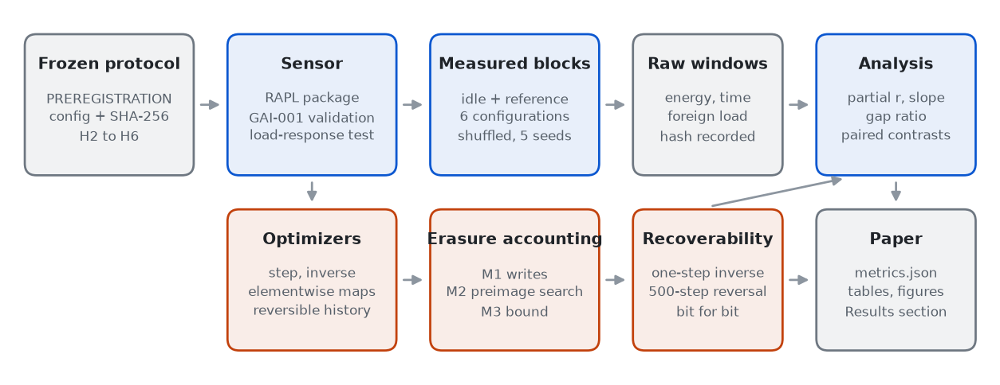
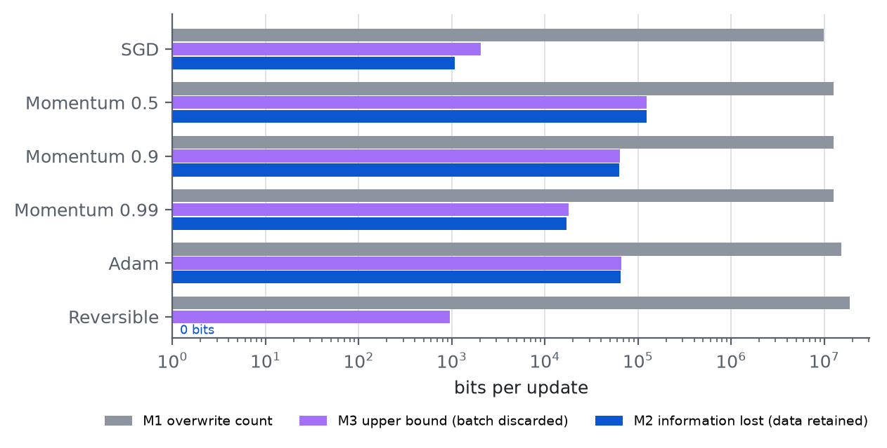

<div align="center">


<h1>Logical Irreversibility in Gradient-Based Training: Exact Accounting of Information Loss and Its Relation to CPU Energy</h1>

<p><em>Exact accounting of the information that SGD, momentum and Adam updates destroy in floating point, tested against measured CPU energy and the Landauer bound.</em></p>

<p>
<a href="https://www.python.org/"></a>
<a href="https://pytorch.org/"></a>
<a href="#preregistration"></a>
<a href="tests/"></a>
<a href="LICENSE"></a>
</p>

<p><a href="#overview">Overview</a> &nbsp;|&nbsp; <a href="#methodology">Methodology</a> &nbsp;|&nbsp; <a href="#main-results">Results</a> &nbsp;|&nbsp; <a href="#installation">Installation</a> &nbsp;|&nbsp; <a href="#reproducing-the-results">Reproduce</a> &nbsp;|&nbsp; <a href="#repository-structure">Structure</a> &nbsp;|&nbsp; <a href="#researcher">Researcher</a> &nbsp;|&nbsp; <a href="#citation">Citation</a></p>

</div>

---

## Overview

Thermodynamic arguments about learning often treat every overwritten bit of a model as erased and compare that count with Landauer's bound of kT ln 2 per bit. Once the training batch is kept, however, SGD, momentum and Adam updates are invertible in exact arithmetic, so information is lost only through finite precision: rounding, absorption of small values into large ones, and decay of optimizer state.

This repository computes that loss exactly, operation by operation, and then asks in a preregistered experiment with measured CPU package energy whether the information lost predicts the energy spent.

The Python package is `landauergap` (project name **LandauerGap**).

## Methodology

| | |
|:--|:--|
| **Model and task** | A 64-256-256-10 perceptron (85,002 parameters, float32) written in NumPy so that the order and precision of every operation are explicit; 500 updates of batch 128 on a ten-class Gaussian mixture |
| **Optimizers** | SGD; heavy-ball momentum at 0.5, 0.9 and 0.99 with the same effective step; Adam; and an exactly reversible fixed-point momentum optimizer |
| **Information accounting** | Exact preimage search over the ordering of floating-point values, validated against exhaustive float16 enumeration; three declared conventions (bits written, information lost with the data kept, and an upper bound when batch indices are discarded) |
| **Energy** | CPU package energy (RAPL) in five randomized complete blocks with idle subtraction, four threads pinned to performance cores of an Intel Core Ultra 9 275HX |
| **Statistics** | Partial correlation of energy with erasure given bytes, FLOPs and time, with block-bootstrap intervals; within-family slope bound; leave-one-configuration-out prediction |

<p align="center"></p>
<p align="center"><sub>Pipeline: frozen protocol, validated sensor, randomized measured blocks, untimed erasure accounting on the same seeds, and analysis.</sub></p>

## Main results

- The bits written per update exceeded the information actually lost by **10<sup>2</sup> to 9.18 × 10<sup>3</sup> times**.
- Plain SGD lost 0.0127 bits per parameter per update; momentum and Adam lost up to 1.45. The fixed-point momentum optimizer lost nothing and reversed 500 updates bit for bit.
- More than **98.4%** of the loss sits in optimizer state, and a simple absorption law predicts its size.
- Three momentum settings with identical arithmetic and **sevenfold different erasure used the same energy**, which bounds the cost of an erased bit on this processor below 4.26 × 10<sup>-8</sup> J. The primary partial correlation (0.45, 95% interval -0.32 to 0.645) was too wide to decide.
- Measured energy exceeded the Landauer bound for the erased bits by 10<sup>13.8</sup> to 10<sup>15.8</sup>, and the exactly reversible optimizer used 13.2 mJ more per update than the momentum optimizer it replaced.

<p align="center"></p>
<p align="center"><sub>Bits per update under the three accounting conventions, log scale.</sub></p>

## Tech stack

| | |
|:--|:--|
| **Language** | Python 3.14 |
| **Numerical computing** | NumPy, SciPy |
| **Deep learning** | PyTorch, CPU build |
| **Classical machine learning** | scikit-learn |
| **Energy measurement** | Intel RAPL package energy, read through the Windows Energy Meter Interface or Linux sysfs, accepted only after a load-response test |
| **Plotting** | matplotlib |
| **Configuration** | PyYAML with JSON Schema validation |
| **Testing** | pytest |
| **Reproducibility** | SHA-256 hashed preregistration, fixed seeds and pinned package versions |

## Installation

The results were produced with Python 3.14 and the exact versions in `requirements.txt`. Any recent CPU runs the accounting, the tests and the re-analysis. A new measured session needs a readable CPU package energy counter and an otherwise idle machine.

```bash
git clone https://github.com/dspraneeth07/logical-irreversibility-training.git
cd logical-irreversibility-training
python -m venv .venv
source .venv/bin/activate        # Windows: .venv\Scripts\activate
pip install -r requirements.txt
```

## Reproducing the results

Every block starts from the repository root. These steps need no energy sensor, no GPU and no new training: the
analysis is recomputed from the saved records in `results/` and matches the reported numbers exactly.

**1. Run the tests** <sub>(47 tests)</sub>

```bash
python -m pytest tests -q
```

**2. Check the preregistration hash** <sub>(must match the digest recorded in `metadata.yaml`)</sub>

```bash
python verify_preregistration.py
```

**3. Exact finite-state reference cases** <sub>(small systems where the information lost can be enumerated)</sub>

```bash
cd src
python -m landauergap.cli finite-state
```

**4. Recompute the session from its raw energy windows** <sub>(a few seconds; reproduces every correlation, interval and verdict)</sub>

```bash
cd src
python -m landauergap.cli analyze --config config.yaml --session ../results/cpu-session-1
```

## Running the experiment again

A new run follows the same frozen protocol and decision rules, and refuses to start if the preregistration or its
configuration has changed. Measured quantities such as energy and timing depend on the machine, so a new run gives new
values for them.

**Smoke run of the whole pipeline (about 15 seconds, simulated energy, supports no claim)**

```bash
cd src
python -m landauergap.cli smoke --out ../results/smoke
```

**Measured session (otherwise idle machine)**

```bash
cd src
python -m landauergap.cli session --config config.yaml --out ../results/my-session
```

## Repository structure

```
logical-irreversibility-training/
├── src/                        # source code
│   ├── jouleledger/            # energy instrument: sensor readers, validation and measurement windows
│   └── landauergap/            # experiment pipeline; `cli.py` is the entry point
├── shared/                     # measurement and accounting modules used by the experiment
├── tests/                      # unit, numerical and end-to-end tests
├── results/                    # every session: raw measurements, run records, analysis outputs and figures
├── assets/                     # logo, photo and the figures shown in this README
├── PREREGISTRATION.md          # protocol; the FROZEN block was fixed before the confirmatory run
├── config.yaml                 # preregistered configuration, hashed together with the frozen block
├── config.small.yaml           # small configuration for the smoke run
├── metadata.yaml               # recorded preregistration hashes and run provenance
├── metrics.json                # headline metrics of the reported session
├── verify_preregistration.py   # recomputes the preregistration hashes
├── requirements.txt            # exact package versions
├── conftest.py                 # test configuration
├── CITATION.cff                # citation metadata
└── LICENSE                     # Apache License 2.0
```

## Preregistration

The hypotheses, decision rules, sample size and analysis were written down and hashed before the confirmatory run.
The text between `FROZEN:BEGIN` and `FROZEN:END` in the preregistration is hashed together with its configuration
file using SHA-256, with line endings normalised to LF:

| Files | SHA-256 |
|:--|:--|
| `PREREGISTRATION.md` + `config.yaml` | <code>56867144e8a3611588225dd86c0ff79235f349f1df589afe0ffacadd86dca591</code> |

Step 2 above recomputes this digest. Every deviation from the protocol is recorded with the session it affected in `results/`.

## Reproducibility

| Output | Reproducible? |
|:--|:--|
| Erasure counts and recoverability | Exactly, given the seeds |
| Correlations, intervals and verdicts | Exactly, from the saved raw energy windows (bootstrap seeds are fixed) |
| Energy readings | No: they depend on the machine and its load, so a new session gives new values |

## Researcher

<table>
<tr>
<td width="168" align="center" valign="top">

</td>
<td valign="top">

**Dhadi Sai Praneeth Reddy**<br>
B.Tech. student, Department of Computer Science and Engineering<br>
Vasavi College of Engineering (Autonomous), Hyderabad, India

Research on the measurement of general intelligence and its physical cost, energy-aware machine learning, agentic and multi-agent AI systems, cognitive security and sovereign language models. Every study is run under a preregistered protocol, and its code, raw measurements and analysis are released in full.

<a href="mailto:dspraneeth07@gmail.com">dspraneeth07@gmail.com</a> &nbsp;|&nbsp; <a href="https://orcid.org/0009-0002-1272-4666">ORCID 0009-0002-1272-4666</a> &nbsp;|&nbsp; <a href="https://dspraneeth07.in">dspraneeth07.in</a> &nbsp;|&nbsp; <a href="https://github.com/dspraneeth07">GitHub</a>

</td>
</tr>
</table>

## Citation

If you use this code or these results, please cite:

```bibtex
@misc{reddy2026logical,
  author       = {Dhadi Sai Praneeth Reddy},
  title        = {Logical Irreversibility in Gradient-Based Training: Exact Accounting of Information Loss and Its Relation to CPU Energy},
  year         = {2026},
  howpublished = {\url{https://github.com/dspraneeth07/logical-irreversibility-training}},
  note         = {Code, data and preregistration}
}
```

Machine-readable metadata is in `CITATION.cff`.

## License

Code: Apache License 2.0 (`LICENSE`). Documentation, figures and results: CC BY 4.0.
